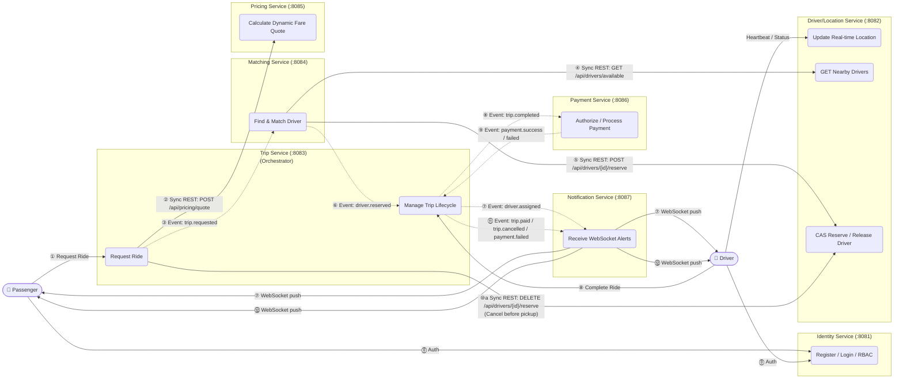
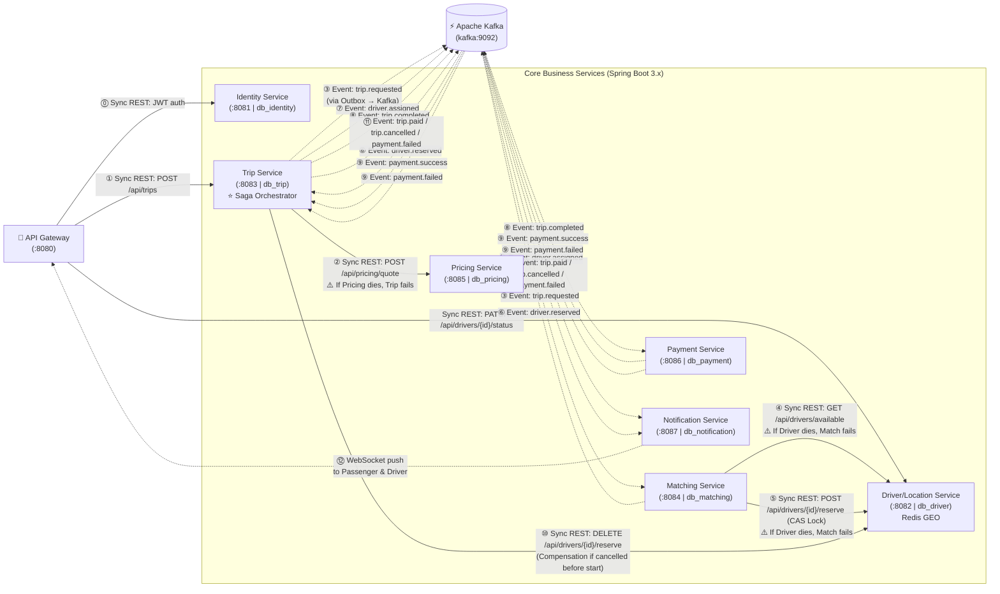
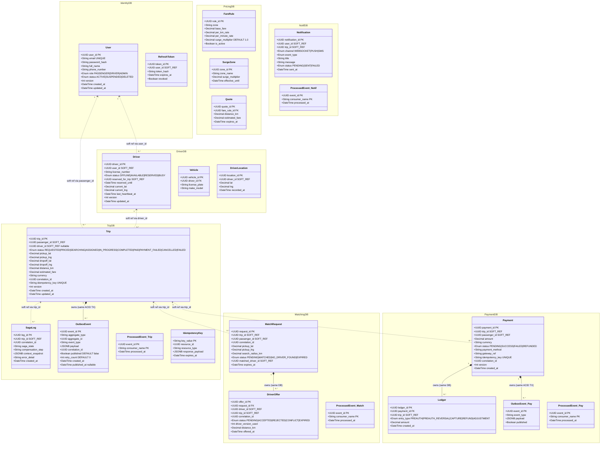

# Ride-Hailing Microservices Architecture Diagrams

As a Software Architect, these UML diagrams strictly adhere to the Database-per-Service pattern, Saga Orchestration, and Eventual Consistency principles.

> **Visual Conventions (Strict)**
> - **Solid lines (`-->` / `->>`)** = **Synchronous REST/HTTP** — tight coupling, caller blocks and waits; requires timeout & circuit breaker.
> - **Dashed lines (`-.->` / `-->>`)** = **Asynchronous Events (Apache Kafka)** — loose coupling, publisher fires and forgets.
> - **Arrow direction** = direction of **dependency** (Caller → Callee), NOT data flow direction.
> - Arrows **never** cross into another service's database directly.

All cross-service relationships use UUID soft references to prevent tight database coupling.

---

## 1. Use Case Diagram (System Interactions)

This diagram maps out the primary functional capabilities of the Passenger and Driver actors against the 7 core microservices.

Conventions: Actor → UseCase uses solid lines (direct interaction). Cross-service dependencies: solid lines = Sync REST, dashed lines = Async Event (Kafka). **Numbered steps ①–⑫** trace the full trip lifecycle order.



---

## 2. Component Diagram (Service Dependencies & Trip Lifecycle Order)

This diagram shows all 7 microservices and their communication channels with API Gateway and Apache Kafka. **Read the line style** to understand coupling risk. **Numbered steps ①–⑫** trace the full lifecycle of one ride booking.

> Legend: **Solid line** = Sync REST (blocking, needs circuit breaker) | **Dashed line** = Async Event via Apache Kafka (fire-and-forget)



---

## 3. Sequence Diagram: Trip Lifecycle & Saga Orchestration

The **Trip Service** acts as the central **Saga Orchestrator**. It maintains global transaction state inside `db_trip` (via `saga_log` table).

- **`->>`** (solid arrow) = **Synchronous REST call** — caller blocks, strict timeout & circuit breaker required.
- **`-->>`** (dashed arrow) = **Asynchronous Event via Apache Kafka** — fire and forget; Transactional Outbox Pattern guarantees at-least-once delivery.

```mermaid
sequenceDiagram
    autonumber
    actor P as 🧍 Passenger
    participant GW as API Gateway (:8080)
    participant Trip as Trip Service (:8083)<br/>(Saga Orchestrator)
    participant Pricing as Pricing Service (:8085)
    participant KF as ⚡ Apache Kafka (9092)
    participant Match as Matching Service (:8084)
    participant Loc as Driver/Location (:8082)
    participant Pay as Payment Service (:8086)
    participant Notif as Notification Service (:8087)

    rect rgb(220, 245, 220)
    Note over P, Notif: 🟢 HAPPY PATH: Ride Request → Driver Match → Completion → Payment Success

    P->>GW: POST /api/trips {pickup, dropoff, passengerId}
    GW->>Trip: POST /api/trips (JWT validated, correlationId injected)
    activate Trip

    Note right of Trip: ⚠️ Sync REST: If Pricing dies, Trip request fails
    Trip->>Pricing: POST /api/pricing/quote {pickup, dropoff, distance} (Sync REST)
    Pricing-->>Trip: 200 OK {estimatedFare: 50000, currency: VND, fareRuleId}

    Trip->>Trip: ACID TX: Save Trip(REQUESTED)<br/>+ Insert saga_log(STARTED)<br/>+ Insert outbox_events(trip.requested)
    Trip-->>GW: 201 CREATED {tripId, status: REQUESTED, estimatedFare}
    deactivate Trip
    GW-->>P: 201 CREATED {tripId, status: REQUESTED, estimatedFare}

    Note over KF: Outbox Relay Worker publishes event to Kafka
    Trip-->>(KF): Publish [trip.requested] {tripId, passengerId, correlationId, pickupLat, pickupLng}
    end

    rect rgb(220, 235, 255)
    Note over Match, Loc: Matching Phase (Async Consumer + Sync CAS Lock)

    (KF)-->>Match: Consume [trip.requested]
    activate Match
    Match->>Match: Save match_requests(PENDING)

    Note right of Match: ⚠️ Sync REST: If Driver/Location dies, Matching fails
    Match->>Loc: GET /api/drivers/available?latitude=X&longitude=Y&radiusKm=3 (Sync REST)
    Loc-->>Match: 200 OK [{driverId, distance, rating, version}] sorted by score

    Note right of Match: ⚠️ Concurrency Control (C1 Race Condition CAS)
    Match->>Loc: POST /api/drivers/{driverId}/reserve {tripId, version} (Sync REST CAS Lock)
    Note right of Loc: UPDATE drivers SET status='RESERVED',<br/>reserved_for_trip=$tripId, version=version+1<br/>WHERE status='AVAILABLE' AND version=$v
    Loc-->>Match: 200 OK {driverId, status: RESERVED, version: N+1}

    Match->>Match: Save driver_offers(ACCEPTED) & match_requests(MATCHED)
    Match-->>(KF): Publish [driver.reserved] {tripId, driverId, correlationId}
    deactivate Match
    end

    rect rgb(255, 248, 220)
    Note over Trip, Notif: Orchestrator Updates Trip State to ASSIGNED

    (KF)-->>Trip: Consume [driver.reserved]
    activate Trip
    Trip->>Trip: ACID TX: Update Trip(ASSIGNED)<br/>+ Update saga_log(DRIVER_RESERVED)<br/>+ Insert outbox_events(driver.assigned)
    deactivate Trip

    Trip-->>(KF): Publish [driver.assigned] {tripId, driverId, correlationId}
    (KF)-->>Notif: Consume [driver.assigned]
    Notif-->>P: WebSocket 🔔 "Driver found! ETA 3 mins"
    Notif-->>Loc: WebSocket 🔔 "New trip assigned to you"
    end

    Note over P, Notif: ... Driver starts ride (Trip IN_PROGRESS) → Driver arrives dropoff ...

    rect rgb(220, 235, 255)
    Note over Loc, Pay: Trip Completion & Payment Charge

    Loc->>Trip: POST /api/trips/{tripId}/complete (Driver action, Sync REST)
    activate Trip
    Trip->>Trip: ACID TX: Update Trip(COMPLETED)<br/>+ Update saga_log(TRIP_COMPLETED)<br/>+ Insert outbox_events(trip.completed)
    Trip-->>Loc: 200 OK
    deactivate Trip

    Trip-->>(KF): Publish [trip.completed] {tripId, passengerId, finalFare, currency, correlationId}
    (KF)-->>Pay: Consume [trip.completed]
    activate Pay
    Note right of Pay: Check processed_events for deduplication<br/>INSERT ON CONFLICT DO NOTHING
    Pay->>Pay: ACID TX: Save Payment(SUCCESS)<br/>+ Insert ledger(CAPTURE)<br/>+ Insert processed_events(eventId)<br/>+ Insert outbox_events(PaymentSucceeded)
    deactivate Pay
    Pay-->>(KF): Publish [payment.success] {tripId, paymentId, amount, correlationId}

    (KF)-->>Trip: Consume [payment.success]
    Trip->>Trip: Update Trip(PAID) + saga_log(SAGA_COMPLETED)
    Trip-->>(KF): Publish [trip.paid] {tripId, correlationId}
    (KF)-->>Notif: Consume [trip.paid]
    Notif-->>P: WebSocket 🔔 "Trip paid successfully. Thank you!"
    end

    rect rgb(255, 220, 220)
    Note over P, Notif: 🔴 COMPENSATION PATH 1: Passenger Cancels During Matching/Assigned

    P->>GW: POST /api/trips/{tripId}/cancel
    GW->>Trip: POST /api/trips/{tripId}/cancel
    activate Trip
    Trip->>Trip: ACID TX: Update Trip(CANCELLED)<br/>+ Update saga_log(COMPENSATING)

    Note right of Trip: Compensation: Release reserved driver back to AVAILABLE
    Trip->>Loc: DELETE /api/drivers/{driverId}/reserve (Sync REST Compensation)
    Loc-->>Trip: 200 OK {driverId, status: AVAILABLE}

    Trip->>Trip: Update saga_log(SAGA_COMPENSATED)<br/>+ Insert outbox_events(trip.cancelled)
    deactivate Trip
    Trip-->>(KF): Publish [trip.cancelled] {tripId, reason: "Passenger cancelled", correlationId}
    (KF)-->>Notif: Consume [trip.cancelled]
    Notif-->>Loc: WebSocket 🔔 "Trip cancelled by passenger. You are AVAILABLE."
    end

    rect rgb(255, 235, 235)
    Note over P, Notif: 🔴 ALTERNATIVE PATH 2: Post-trip Payment Fails (Debt / Retry Log)

    (KF)-->>Pay: Consume [trip.completed]
    activate Pay
    Pay->>Pay: ACID TX: Save Payment(FAILED)<br/>+ Insert ledger audit<br/>+ Insert outbox_events(payment.failed)
    deactivate Pay
    Pay-->>(KF): Publish [payment.failed] {tripId, reason: "Card declined", correlationId}

    (KF)-->>Trip: Consume [payment.failed]
    activate Trip
    Note right of Trip: Ride was finished! Driver is already AVAILABLE.<br/>Do NOT rollback driver. Mark Trip as PAYMENT_FAILED for retry/debt collection.
    Trip->>Trip: Update Trip(PAYMENT_FAILED)<br/>+ Update saga_log(COMPENSATED, error="Payment failed")
    deactivate Trip
    Trip-->>(KF): Publish [payment.failed] {tripId, correlationId}
    (KF)-->>Notif: Consume [payment.failed]
    Notif-->>P: WebSocket 🔔 "Payment failed. Please update payment method."
    end
```

---

## 4. Class Diagram (Domain Models & Distributed Patterns)

Each namespace represents a separate, isolated PostgreSQL database conforming to [database_schema.md](file:///d:/Nam_4/He-thong-phan-tan/ds-project/docs/database_schema.md). Dashed arrows (`..>`) indicate UUID soft references — no physical `FOREIGN KEY` constraints cross database boundaries.



---

## Architectural Decisions & Distributed Systems Constraints

| Concern | Implementation | Trade-off |
|---|---|---|
| **Message Broker** | **Apache Kafka** (`kafka:9092`) with consumer groups and persistent topics (`trip.requested`, `driver.reserved`, `trip.completed`, etc.). | High throughput, partition-ordered log; requires ZooKeeper/KRaft. |
| **Transactional Outbox** | Save business entity + `outbox_events` in one ACID TX. Relay worker polls and publishes to Kafka. | Adds background relay polling; completely eliminates dual-write split-brain. |
| **Consumer Deduplication** | `processed_events` table per consumer. `INSERT ... ON CONFLICT DO NOTHING` in same TX as consumer logic. | Extra DB write per event; guarantees idempotent exactly-once processing side-effects. |
| **CAS / Optimistic Lock** | `version` column on `trips` and `drivers`. `UPDATE ... WHERE version = $v` returns 0 rows on conflict → retry/409. | Requires client retry logic; avoids pessimistic DB-level row locks and deadlocks. |
| **Saga Orchestration** | `Trip Service` acts as Saga Orchestrator, recording global state in `saga_log`. Compensating actions are driven centrally. | Orchestrator handles timeouts and rollbacks; easier to monitor & trace than distributed choreography. |
| **Correlation IDs** | Injected at API Gateway (`X-Correlation-Id`). Propagated through all REST headers and Kafka event headers/payloads. | Enables complete distributed tracing across Jaeger/Zipkin for all 7 microservices. |
| **Circuit Breakers** | Resilience4j circuit breakers and timeouts (2s) on all synchronous REST calls (`Trip → Pricing`, `Matching → Driver`). | Prevents cascading failures when downstream dependencies slow down or crash. |
